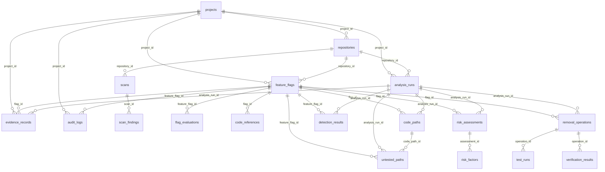

# Feature Flag Lifecycle with Stale Flag Detection

A complete engineering system — not just a dashboard. The React UI operates a FastAPI
backend that discovers feature flags (FlagShark), tracks their lifecycle in PostgreSQL,
detects stale candidates with explainable evidence, assesses removal risk, and performs
safe, audited removals (Piranha) with dry-run, verification, and rollback.

## 1. System architecture

```
Browser (:3000, nginx) ──REST/JSON──▶ FastAPI (:8000) ──SQLAlchemy──▶ PostgreSQL (:5432, pgdata volume)
        │                                    │  ▲
        │ falls back to                      │  │ subprocess (arg arrays, never shell)
        │ bundled mocks                      ▼  ▼
        │                              FlagShark   Piranha   git   mvn/npm/pytest   JaCoCo XML
        │                              (scan)      (remove)  (evidence/safety) (verify) (coverage)
        └─────────────────────────────────────────────────────────────────────────
```

## 2. Technology stack

| Layer | Tech |
|---|---|
| Frontend | React 18 + TypeScript + Vite, TailwindCSS, React Router v6, Lucide |
| Backend | Python 3.11, FastAPI, Pydantic v2, Uvicorn |
| ORM / migrations | SQLAlchemy 2.x, Alembic (batch mode for SQLite) |
| Primary database | PostgreSQL 16 (Docker volume `pgdata`, persists across restarts) |
| Dev/test database | SQLite file (zero-setup local runs and unit tests) |
| Analysis tools | FlagShark (scan), Piranha (removal), git (evidence/safety), Maven/JaCoCo (verify) |
| Deployment | Docker Compose: `postgres`, `ffsd-backend`, `ffsd-frontend` (nginx) |

## 3. Database architecture

PostgreSQL is primary in Docker (`DATABASE_URL` DSN). SQLite remains the default for
local dev/tests when no Postgres is configured. One Alembic chain serves both dialects.

19 tables: UI-mirroring tables (`repositories`, `scans`, `scan_findings`, `feature_flags`,
`evidence_records`, `code_references`, `code_paths`, `risk_assessments`, `risk_factors`,
`removal_operations`, `test_runs`, `verification_results`, `reports`) plus lifecycle tables
(`projects`, `flag_evaluations`, `analysis_runs`, `detection_results`, `untested_paths`,
`audit_logs`). Lifecycle columns extend the UI tables without changing their API shapes
(all responses stay camelCase-compatible with `src/types/index.ts`).

## 4. Database ER diagram



## 5. Backend architecture (`backend/app/`)

```
main.py            lifespan: wait_for_db → init_db (no-op if migrated); no demo seeding (tests/fixtures.py is test-only)
config.py          env-first settings; effective_database_url() prefers explicit Postgres DSN
database.py        engine/session factory (sqlite + postgres), wait_for_db, get_db DI
models/            models.py (UI tables + lifecycle columns) · lifecycle_models.py (projects,
                   evaluations, runs, detections, untested, audit + state machine constants)
schemas/           Pydantic request/response models, camelCase aliases; ORM never leaks out
services/          git, flagshark, piranha, test(JaCoCo), codepath, evidence,
                   detection (scoring), risk, lifecycle (transitions), audit
routers/           health, projects, repositories, scans, flags, analyze,
                   analysis_runs, removals, reports (+ mappers DB→schema)
```

Tool execution lives in `services/*`, never in routes; subprocesses use argument arrays,
timeouts, and captured output stored on the run/operation rows.

## 6. API endpoints

Legacy UI contract (unchanged): `GET /api/health`, `/api/repositories…`,
`/api/scans…`, `/api/flags…`, `/api/flags/stale`, `/api/flags/{id}/evidence|references|code-paths|risk`,
`POST /api/flags/{id}/analyze|/remove`, `/api/removals…`, `/api/verifications`,
`/api/test-runs/{id}`, `/api/reports…`, `/api/tools/status`.

Lifecycle additions:

```
GET    /health  ·  GET /health/db (real SELECT 1 + dialect)
GET/POST /api/projects · GET /api/projects/{id}
GET/POST /api/projects/{id}/flags
PATCH  /api/flags/{id}                     # lifecycle_state validated, 422 on invalid jump
GET    /api/flags/{id}/history             # audit trail per flag
GET/POST /api/flags/{id}/evaluations       # real evaluation telemetry
GET    /api/analysis · POST /api/analysis/run · GET /api/analysis/{id}
GET    /api/detection-results · GET /api/untested-paths
POST   /api/risk-assessments               # persisted recommendation
POST   /api/removals/dry-run               # plan only, repo untouched
POST   /api/removals                       # approved removal (?confirmed_high_risk=true for HIGH/CRITICAL)
POST   /api/removals/{id}/rollback         # restore safety branch
GET    /api/evidence · GET /api/audit-logs
```

## 7. Environment variables

See `.env.example` (root) and `backend/.env.example`. Key entries:

```
VITE_API_URL=http://127.0.0.1:8000
POSTGRES_DB/POSTGRES_USER/POSTGRES_PASSWORD   # compose; never commit real passwords
DATABASE_URL                                   # postgres DSN in compose; sqlite file locally
FRONTEND_ORIGIN                                # CORS (compose: http://localhost:3000)
WORKSPACE_DIR · FLAGS_HARK_BIN · PIRANHA_BIN · GIT_BIN · MVN_BIN
SCAN/PIRANHA/TEST_TIMEOUT_SEC
```

## 8. Docker setup

```bash
docker compose up --build     # postgres → backend (waits healthy, migrates; DB starts empty) → frontend
docker compose logs -f ffsd-backend
docker compose down           # data persists in pgdata; -v wipes it
```

- `postgres:16-alpine` with `pgdata` volume + `pg_isready` healthcheck.
- Backend `depends_on: postgres (service_healthy)` and also `wait_for_db()` at startup.
- Frontend (nginx) serves the SPA on `http://localhost:3000`, API on `:8000`.

## 9. Database migration commands

```bash
cd backend
python -m alembic upgrade head        # safe on empty and existing DBs; additive only
python -m alembic revision --autogenerate -m "describe change"
python -m alembic current             # show applied revision
```

## 10. Test fixtures (never auto-inserted at runtime)

The production backend starts with an empty database: no demo seeding occurs on startup.
The representative dataset used by the automated suite lives in
`backend/tests/fixtures.py` and is imported only by `backend/tests/*.py`:

```bash
cd backend
python -m pytest tests/ -q                                   # sqlite: uses tests/fixtures.py
TEST_POSTGRES_URL=postgresql+psycopg://ffsd:pw@h:5432/ffsd \
  python -m pytest tests/test_postgres.py -q
```

## 11. Detection workflow

`POST /api/analysis/run` → per flag gathers FlagEvaluation rows, code-reference counts,
git `-S<flag>` history → `detection_service.evaluate()` scores 0–100:

```
+30 inactive≥180d · +18 ≥90d · +5 any inactivity · +12 rollout 100% · +10 zero 7d evals
+25 zero code refs · +10 expiry passed · +8 no flag commits ≥180d · −15 modified <30d
STALE (≥60, ≥2 signals) · CANDIDATE (≥35, ≥2) · REVIEW_REQUIRED (≥35, <2)
ACTIVE (below) · REJECTED (no evidence at all — never called stale)
```

Every verdict persists a `detection_results` row (score, confidence, reasons, evidence
summary) plus `DETECTION_RESULT` evidence and an audit entry. Valid
`CONCLUDED → STALE_CANDIDATE` flags transition automatically; others keep lifecycle state.

## 12. Risk assessment workflow

`POST /api/risk-assessments {flag_id}` combines evidence, code paths, coverage, last test
run, and repo state into score/level/factors, then maps to a recommendation:
`DO_NOT_REMOVE` (failing tests or CRITICAL), `REVIEW_REQUIRED` (HIGH, untested/unknown
coverage), else `SAFE_TO_REMOVE`. Stored with affected paths, environments, dependency
count, rollback availability; HIGH/CRITICAL removals require `?confirmed_high_risk=true`.

## 13. Removal workflow

1. Candidate detected with evidence → 2. risk assessed → 3. `POST /api/removals/dry-run`
shows planned files/lines (repo untouched) → 4. user approves via `POST /api/removals`
→ 5. git safety branch + base commit recorded → 6. Piranha executes (stdout/stderr/diff
captured) → 7. test suite runs, JaCoCo parsed where present → 8. verification
(SUCCESS only if refs gone AND tests green) → 9. lifecycle → REMOVED, audit entries
throughout → 10. `POST /api/removals/{id}/rollback` restores the safety branch and marks
the operation ROLLED_BACK. Database state and source removal stay distinguishable;
flags are never deleted, never silently modified.

## 14. Piranha integration (verified Polyglot Piranha 0.4.9)

Distribution: PyPI `polyglot-piranha==0.4.9` (Uber Piranha, Apache-2.0; pinned
in `requirements.txt`; Docker build asserts the exact version). Execution is
via the Python API in an isolated subprocess (`piranha_runner.py`) with
timeout — Rust panics (bad language, missing holes/config) can never take
down the backend. Shipped rule configs (`backend/piranha_configs/`) cover
`python`, `typescript`, `tsx` only: seed rules rewrite flag reads in `if`
conditions to the treated boolean literal, chained rules simplify `if
True/False` blocks, boolean expressions, single-name imports, and flag
definitions. Anything else is `UNSUPPORTED` (refused, never guessed); unknown
patterns yield `NO_CHANGES`. Dry-run is mutation-free and purity-verified;
approved cleanup captures the real unified `git diff`, runs tests + Python
syntax check + reference re-scan + post-cleanup FlagShark re-scan, and rolls
back via safety branch + `reset --hard` to the recorded base. Known
limitation: nested-`if` consequence blocks in Python rewrite with broken
indentation — verification catches it and the operation FAILS (never SUCCESS).

## 15. FlagShark integration (verified against the official CLI v2.8.0)

Official tool: `FlagShark/flagshark` (npm `flagshark@2.8.0`, pinned in
`backend/Dockerfile` alongside pinned Node.js 22.23.4). Verified command:
`flagshark scan --format json` with cwd = repository (no positional path arg).
Exit 0 = no stale flags, 1 = stale found, 2 = runtime/config error.
The JSON `flags[]` array contains STALE flags only (one entry per unique flag,
first location; absolute paths relativized, escapes rejected). Per-flag fields
persisted: name, file, line, language, provider, stale, string confidence tier
(mapped to 0.9/0.6/0.3), signals, age. FlagShark reports no AST node types, so
`ast_node_type` stays `"Unknown"`; its stale verdict is recorded, while the
FlagOps detection engine remains the lifecycle authority. Structured
`stale-signal` evidence rows carry provider/language/signals/age.
Unparseable output, timeouts, and exit-2 failures are recorded honestly and
supplemented by the labelled `Regex-Fallback` scan; with no binary and no
references the scan is `failed` with an install hint — never fabricated
FlagShark results. Golden fixture:
`backend/tests/fixtures/flagshark/actual_scan_output.json`.

## 16. Testing instructions

```bash
cd backend
python -m pytest tests/ -q                                   # sqlite: full suite
TEST_POSTGRES_URL=postgresql+psycopg://ffsd:pw@h:5432/ffsd \
  python -m pytest tests/test_postgres.py -q                 # real FK/migration/seed checks
```

Covers: health, CRUD, lifecycle valid/invalid transitions, REJECTED-vs-STALE detection,
untested paths, risk recommendations, dry-run purity, refusal paths (no silent success),
real git rollback restore, tool-missing handling, FlagShark adapter (golden fixture),
Piranha adapter (golden byte-equality, dry-run purity, NO_CHANGES, UNSUPPORTED,
rollback restore), LaunchDarkly provider detection/cleanup, evaluation metrics,
security regression (token redaction, traversal, injection, no-shell), Docker E2E.

```bash
# Full suite with real tools (Docker image has Node 22 + pinned packages):
docker build -q ./backend -t ffsd-backend
docker run --rm -v $PWD/backend:/srv/backend \
  -e DATABASE_URL="sqlite:////tmp/t.db" -e WORKSPACE_DIR=/tmp/ws \
  ffsd-backend python -m pytest tests/ -q -m "not integration"
```

## 17. Phase 4: provider support, verification & evaluation

**SUPPORTED** (verified by executed runs, golden-pinned):
- FlagShark 2.8.0 code detection; Regex-Fallback inventory scan.
- ProviderAST inventory for LaunchDarkly literal-key calls:
  Python `variation("FLAG", ...)` (incl. chained `ldclient.get().variation(...)`);
  TypeScript `variation|boolVariation|stringVariation|numberVariation|jsonVariation`
  with literal keys. Findings carry source `ProviderAST(launchdarkly)`, never FlagShark.
- Piranha 0.4.9 cleanup for `python`/`typescript`/`tsx`: bare-`if` flags AND
  LaunchDarkly call seeds → treated literal → shared if/bool/import/definition
  cleanup. NO_CHANGES stays honest (unsupported pattern/provider → FAILED, never fake SUCCESS).
- Python syntax gate (py_compile), test execution with workdir reporting,
  post-cleanup FlagShark re-scan, byte-identical rollback.

**EXPERIMENTAL / partial:**
- Test discovery in subdirectories (depth ≤ 3, monorepo-aware) and explicit
  TOOL_UNAVAILABLE when markers exist but the binary is missing.
- Java/Maven: detection + `mvn -q test` execution where Maven exists; otherwise
  explicit unavailable (no Java Piranha cleanup — out of scope).

**UNSUPPORTED (fail closed, documented):**
`*Detail` SDK variants, computed/env-derived keys, ternaries, nested-Python-if
dedent, multi-name imports, aliased imports, non-literal keys, languages without
verified rule configs, attribute/subscript flag uses (`flags.X`, `X[FLAG]`
— guarded by `not_enclosing_node`).

**Evaluation** (`backend/tests/fixtures/eval/`, `test_evaluation.py`):
measured on real runs — Detection P=1.000 R=1.000 F1=1.000 (TP=2 FP=0 FN=0),
stale 1/1; Cleanup success 0.60 / NO_CHANGES 0.20 / unsupported 0.20
(by design the corpus includes honest negative paths); rollback 2/2;
false cleanups 0. Metric definitions live in `manifest.json`.

## 18. Troubleshooting

| Symptom | Cause / fix |
|---|---|
| Backend exits on first boot, then runs | Normal if seed raced; fixed seed uses parent-first flushes — check `docker logs ffsd-backend` |
| `422 invalid lifecycle transition` | Move flags step-by-step: ACTIVE→ROLLOUT→CONCLUDED→STALE_CANDIDATE→RISK_REVIEW→REMOVAL_PENDING→REMOVED |
| Removal `422` (risk guard) | Create/update risk assessment; HIGH/CRITICAL needs `?confirmed_high_risk=true` |
| Removal `400` (checkout UNAVAILABLE) | Register the repository with a real `local_path` first |
| Scan `failed` "FlagShark is not installed" | Install FlagShark or rely on the labelled Regex-Fallback scan |
| Frontend shows mock data | Backend unreachable — check `VITE_API_URL` and `docker compose ps` |
| `ValueError: Constraint must have a name` (old sqlite DBs) | Fixed via named FKs + batch mode; rebuild from `alembic upgrade head` on a fresh DB |

## License

MIT
